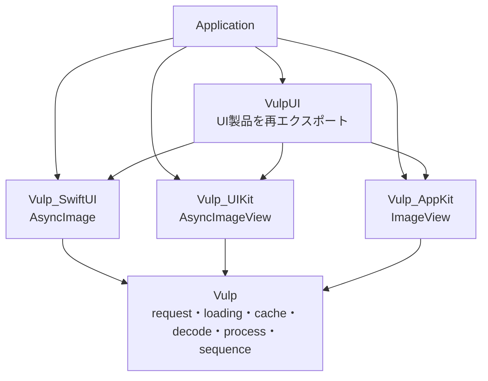

# Vulpのアーキテクチャ

この文書は現在の実装を説明するアーキテクチャ概要です。変更の理由や選択肢を記録するADRではありません。設計判断は [`docs/adr/`](adr/README.md) を参照してください。

## パッケージの境界

`Vulp` は画像読み込みの仕組みを持ち、UIターゲットには依存しません。SwiftUI・UIKit・AppKitの各ターゲットは `Vulp` に依存し、それぞれのビュー、表示状態、再生スケジュールを担当します。`VulpUI` はUIターゲットをまとめて再エクスポートするための製品です。

## 静止画像の読み込み

```mermaid
flowchart LR
    View[SwiftUIまたはUIKitのView] --> Request[MediaImageRequest]
    Request --> Loader[DefaultMediaImageLoader]
    Loader -->|decoded cache hit| Image[処理済みMediaImage]
    Loader -->|miss| RequestDeduper[request key単位のImageFetchDeduper]
    RequestDeduper --> DataCache[asset key単位のImageDataCache]
    DataCache -->|hit| Encoded[encoded source bytes]
    DataCache -->|miss| Asset[MediaAsset]
    Asset --> Downloader[ImageDataDownloader]
    Downloader --> Encoded
    Encoded --> Resolver[MediaSourceResolver]
    Resolver --> Decoder[MediaImageDecoderSet]
    Decoder --> Processor[ImageProcessor]
    Processor --> DecodedCache[ImageCache]
    DecodedCache --> Image
    Image --> View
```

### Requestと識別子

`MediaImageRequest` は `MediaAsset` と、出力ピクセルサイズ、描画モード、リサイズ方式、デコードオプションをまとめます。近い出力サイズを同じサイズバケットに丸め、assetと出力条件から `cacheIdentifier` を作ります。この識別子を使って、同じ処理済み画像を再利用し、同時に発生した同じrequestの処理をまとめます。

Viewのboundsからサイズを決める場合、UIターゲットは表示scaleもrequest作成に渡します。requestは表示するpoint数に必要なpixel数を表します。

### Loaderの処理

`DefaultMediaImageLoader` が次の段階をまとめます。

1. `ImageCache` から処理済み画像を探す。
2. キャッシュになければ、`ImageFetchDeduper` で同じrequestの進行中処理に参加するか、新しく開始する。
3. encoded source bytesを `ImageDataCache` から読む。なければassetやdownloaderから取得する。
4. sourceの種類を判定し、画像または動画フレームをデコードする。
5. requestのサイズや描画オプションに合わせて画像を処理する。
6. 処理済み画像を `ImageCache` に保存し、呼び出し元へ返す。

`ImageFetchDeduper` が共有するのは処理中の仕事だけです。待っている呼び出し元を追跡するため、一つのViewがキャンセルされても、同じ画像を待つ別の呼び出しがあれば仕事は続きます。待ち手がなくなった時点で、元の処理をキャンセルします。

読み込み、デコード、画像処理のasync APIには `@concurrent` を指定し、同期的な画像処理が呼び出し元のUI actor上で実行されないようにしています。UIターゲットはawait後に表示状態を更新します。

### Source、decoder、processorの役割

- `MediaAsset` はsourceの識別子と読み込み方法を表します。標準実装はremote URL、ローカルファイル、すでにあるDataを扱います。
- `ImageDataDownloader` はremote bytesを取得します。`MediaSourceResolver` はsource情報を見て、画像データ経由か動画フレーム経由かを選びます。
- `MediaImageDecoding` の実装はencoded dataをplatform imageに変換します。標準のdecoder setは静止画・アニメ画像にImageIO、動画フレームにAVFoundationを使います。
- `ImageProcessor` はデコード後の画像を変換します。標準の `ResizeImageProcessor` はsourceの縦横比を保ちながら `.fit` と `.fill` を処理します。

これらは差し替え可能なprotocolです。アプリは独自のasset、downloader、decoder、processor、loaderを提供できます。Viewの処理をcoreターゲットへ移す必要はありません。

## Cacheの役割

保存する値と利用段階が異なるため、Vulpには二つのcacheがあります。

| Cache | 保存するもの | 標準設定 |
|---|---|---|
| `ImageCache` | request識別子に対応するデコード・処理済みplatform image | `InMemoryImageCache` / `LRUImageCache`、最大200件 |
| `ImageDataCache` | asset識別子に対応するencoded source bytes | `DiskImageDataCache`、最大100 MiB、7日間 |

メモリcacheにヒットすると、非同期のcache lookup後にデコード済み画像を返せます。encoded sourceだけが残っている場合は、再ダウンロードせずにデコードと画像処理をやり直します。`clearCache()` はそのloaderが持つ両方のcacheを消去します。

標準cacheはactorで状態を隔離します。アプリが必要に応じて、`LayeredImageCache` でmemory cacheと共有backing cacheを組み合わせることもできます。標準loaderはデコード済み画像にin-memory cacheを、encoded source bytesに別のdisk cacheを使います。

## アニメーション画像のsequence

sequenceのsourceは一度取得します。`ImageSequence` はencoded bytesとframe timingを保持し、`ImageSequencePlaybackPlan` は指定された精度に合わせて再生rateとframeを選びます。`ImageSequenceFrameLoader` は通常のloaderにframeごとのrequestを渡します。そのため、frameにも通常のデコード、画像処理、deduplication、cacheの経路が使われます。先読みするframe数は上限付きです。

再生タイミングとViewへの画像設定はUIターゲットが担当します。

- SwiftUIは `TimelineView` とsequence playback modelを使います。
- UIKitは `ImageSequencePlayback` を通じて `UIUpdateLink` を使います。
- 現在のAppKit `ImageView` は画像表示用で、非同期sequence playerは持ちません。

## Viewの役割とライフサイクル

### SwiftUI `AsyncImage`

SwiftUI Viewはrequestを受け取るか組み立て、画像とplaceholderを切り替え、読み込み結果をSwiftUI stateに反映します。URLやview-sized requestでは `GeometryReader` とdisplay scaleからrequestサイズを作ります。`.task(id:)` が読み込みを開始し、task IDの変更やViewが表示階層から外れる時にSwiftUIがtaskをcancelまたは再実行します。

`@State` は一時的な `View` structの値ごとではなく、SwiftUI上のView identityに結び付いています。Vulpは表示に成功した静止画像の識別子を覚え、同じrequestのtaskが再実行された時に画像を残して重複ロードを避けます。アニメーションsequenceは再表示時に再生を再開できるよう別経路で扱います。

### UIKit `AsyncImageView`

`AsyncImageView` は `UIImageView`、request builder、現在のtask、sequence playback driverを所有します。`bounds` とdisplay scaleからrequestサイズを作ります。`layoutSubviews` はrequestのcache identifierが変わったかを確認し、`willMove(toSuperview:)` と `didMoveToWindow()` はdetach時のcancelとattach時の再開を扱います。

Viewは現在のtask識別子とは別に、正常に表示できたrequestの識別子を保持します。再attach時に同じ画像が `UIImageView` に残っていれば、その画像を保ったまま再ロードを省きます。URL由来の静止sequenceも同様に扱います。アニメーションsequenceは再生を再開するため再ロードしますが、読み込み中も現在のframeを表示し続けます。

Collection Viewのcell再利用は呼び出し側の責務です。別のmodelをcellに割り当てる時は、画像を消すか新しいrequestを設定してください。request identifierが変わると新しいロードを開始し、前のrequestの遅い結果が新しい画像として設定されないようにします。

### Viewのライフサイクル処理を一つのクラスにしない理由

共通化できる小さな方針は「成功した画像を安定したrequest識別子に結び付け、同じ識別子の時だけ再利用する」ことです。その周辺のライフサイクルはplatformごとに異なります。

- SwiftUIはvalue view、identityに結び付いた `@State`、自動管理される`.task(id:)` cancellationを使います。
- UIKitは永続する `UIView`、明示的なattach/detach callback、layout callback、子 `UIImageView` を使います。
- sequence playbackも異なるスケジューリングAPIを使います。

Loader、request identity、frame loading、cacheは共有し、各UIターゲットはライフサイクルと表示状態を持ちます。これによりcoreをUI非依存に保ち、それぞれのintegrationをplatformの慣習に沿わせています。

## 関連するADR

- [ADR 0002: UIターゲットの境界](adr/0002-ui-target-boundaries.md)
- [ADR 0003: 画像処理をUI actorの外で実行する](adr/0003-run-image-work-off-ui-actors.md)
- [ADR 0004: image sequenceのframe単位ロードとcache](adr/0004-image-sequence-frame-loading.md)
- [ADR 0006: sequence frameの先読み上限](adr/0006-bounded-sequence-prefetch.md)
- [ADR 0007: 出力画像サイズのbucket化](adr/0007-bucket-image-output-sizes.md)
- [ADR 0008: SwiftUIとUIKitの画像サイズ動作の整合](adr/0008-swiftui-uikit-image-sizing-parity.md)
